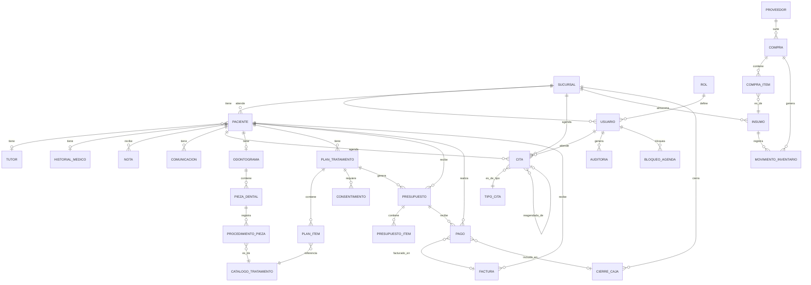
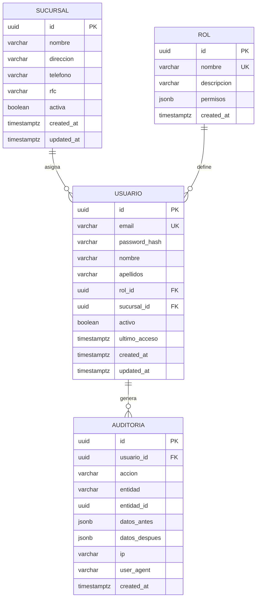
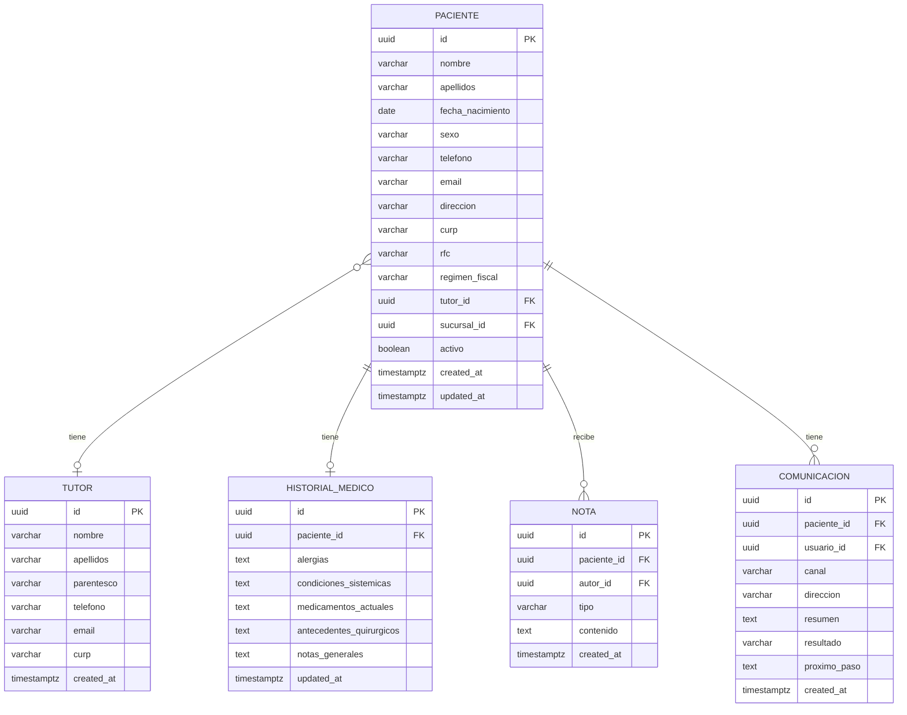
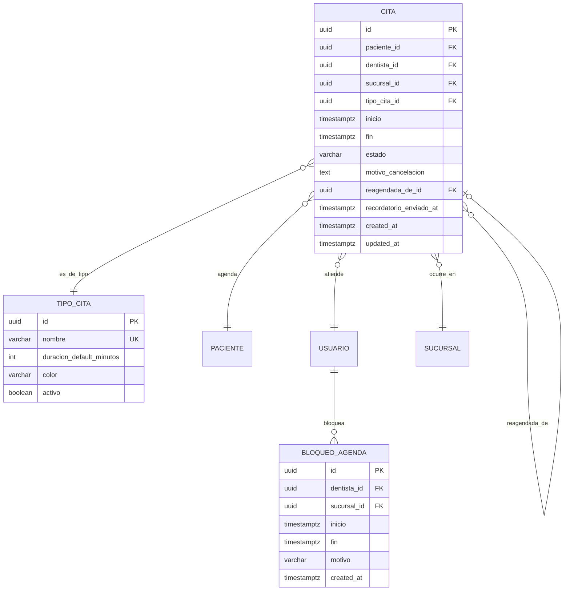
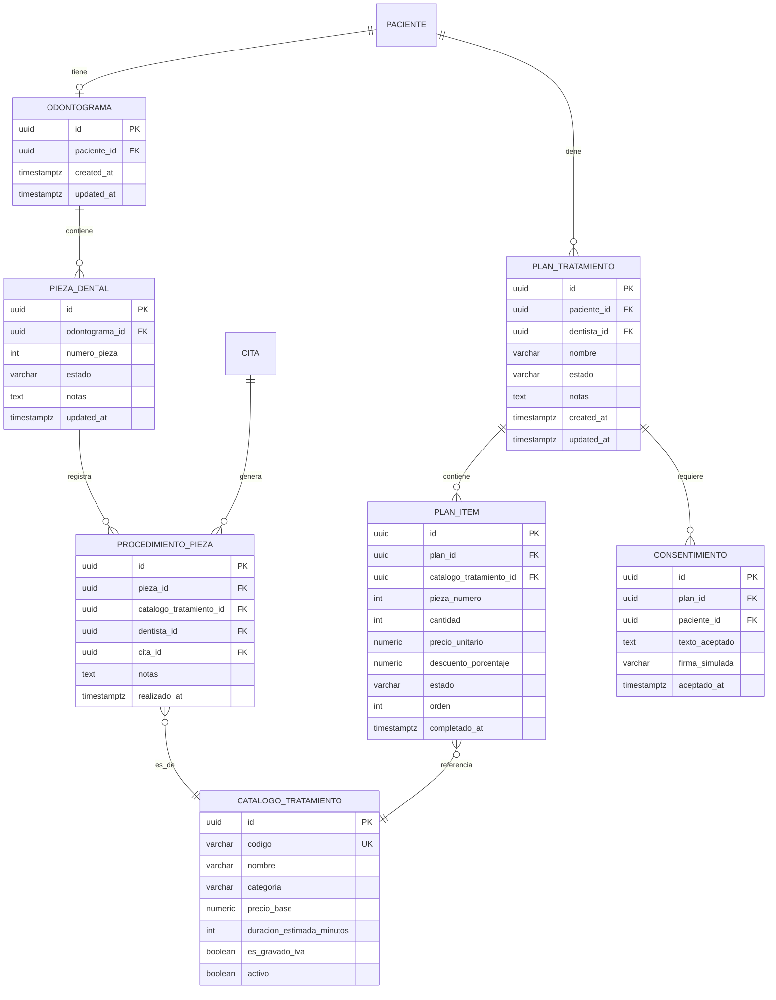
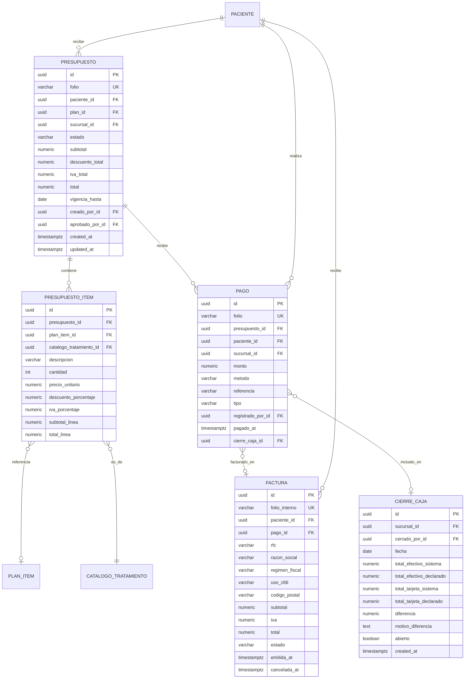
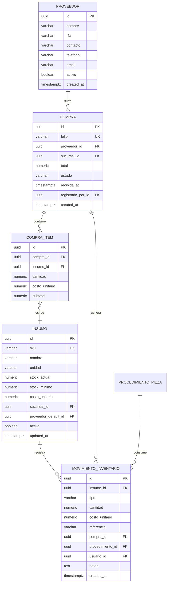
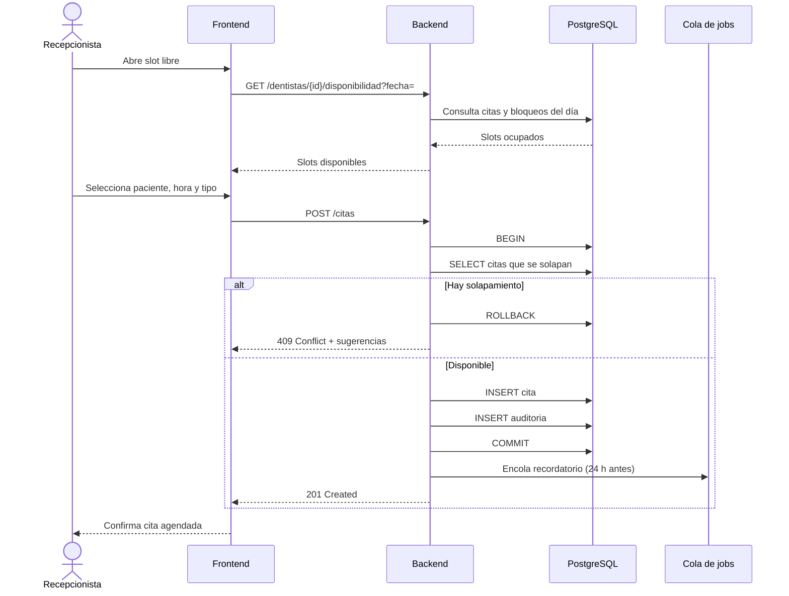

# 04. Modelo de Datos

## Tabla de contenidos

1. [Convenciones](#convenciones)
2. [Vista general](#vista-general)
3. [Módulo Sistema](#módulo-sistema-auth-usuarios-auditoría)
4. [Módulo CRM](#módulo-crm-pacientes)
5. [Módulo Agenda](#módulo-agenda-citas)
6. [Módulo Clínico](#módulo-clínico-odontograma-y-tratamientos)
7. [Módulo Comercial](#módulo-comercial-presupuestos-pagos-facturas-cierre)
8. [Módulo Operación](#módulo-operación-inventario-compras)
9. [Matriz de trazabilidad](#matriz-de-trazabilidad-rf--entidad)
10. [Seeds iniciales](#seeds-iniciales-datos-de-demo)
11. [Decisiones técnicas](#decisiones-técnicas-del-modelo)
12. [Convenciones de nombres](#convenciones-de-nombres)
13. [Diagrama de secuencia](#diagrama-de-secuencia-agendar-cita-cu-01)

---

## Convenciones

| Concepto | Regla |
|---|---|
| **Identificadores** | `uuid` v4 en todas las tablas. Evita colisiones, no filtra volumen y es seguro en URLs. |
| **Timestamps** | `timestamptz` (con zona horaria). Todo registro tiene `created_at` y `updated_at`. |
| **Soft delete** | Campo `activo boolean` en entidades de negocio (pacientes, insumos, usuarios). Nunca se borra físicamente. |
| **Dinero** | `numeric(12,2)`. Nunca `float`. |
| **Enumeraciones** | `varchar` con restricción `CHECK`. |
| **Nombres de tablas** | `snake_case` en plural (`pacientes`, `citas`). |
| **Nombres de columnas** | `snake_case` en singular. |
| **Llaves foráneas** | `{tabla_singular}_id` (por ejemplo, `paciente_id`). |
| **Índices** | Toda llave foránea lleva índice, al igual que los campos de búsqueda frecuente. |
| **Datos no expuestos** | `password_hash` nunca sale de la API. |

---

## Vista general

---

## Módulo Sistema (auth, usuarios, auditoría)

### Reglas de negocio

- Un usuario pertenece a una sucursal principal. Si atiende varias, se manejará en una tabla puente futura (`usuario_sucursal`).
- `roles.permisos` es un `JSONB` con la matriz de permisos por módulo, por ejemplo: `{ "pacientes": ["read", "write"] }`.
- `auditoria` es *append-only*: nunca se actualiza ni se borra.
- Contraseñas con bcrypt y costo mayor o igual a 12 (RNF-05).

### Índices

- `usuario(email)`, único.
- `auditoria(usuario_id, created_at DESC)`: búsquedas por usuario.
- `auditoria(entidad, entidad_id)`: historial de un registro.

---

## Módulo CRM (pacientes)

### Reglas de negocio

- `paciente.tutor_id` es obligatorio si la edad es menor a 18 años (RF-CRM-02). Validación en la aplicación.
- Un paciente tiene un único historial médico (relación 1:1, `paciente_id` único).
- `sexo` pertenece a `{M, F, X}`.
- `canal` pertenece a `{telefono, whatsapp, email, presencial}`.
- `resultado` pertenece a `{contactado, no_contactado, reagendado}`.
- CURP y RFC se validan con expresiones regulares en la aplicación (formato mexicano). En el MVP no se valida el dígito verificador.

### Índices

- `paciente(telefono)`, `paciente(email)`, `paciente(rfc)` y `paciente(curp)`: búsqueda según RF-CRM-05.
- `paciente(sucursal_id, activo)`.
- `nota(paciente_id, created_at DESC)`: línea de tiempo.

---

## Módulo Agenda (citas)

### Reglas de negocio

- `estado` pertenece a `{agendada, confirmada, atendida, no_show, cancelada}`.
- **No solapamiento** (RF-AGD-02): se valida dentro de una transacción al crear o editar. En PostgreSQL, la solución ideal sería una restricción `EXCLUDE USING gist` sobre `tstzrange`; en el MVP la validación se realiza en la capa de servicio.
- `reagendada_de_id` es una llave foránea recursiva que garantiza la trazabilidad de reprogramaciones (RF-AGD-05).
- `recordatorio_enviado_at` registra cuándo se envió el recordatorio (RF-AGD-06) y evita duplicados.
- `fin` se calcula a partir de `inicio` y `tipo_cita.duracion_default_minutos`, pero puede modificarse manualmente.

### Índices

- `cita(dentista_id, inicio)`: agenda por dentista.
- `cita(sucursal_id, inicio)`: agenda por sucursal.
- `cita(paciente_id, inicio DESC)`: historial por paciente.
- `cita(estado, inicio)`: detección de no-show del día.

---

## Módulo Clínico (odontograma y tratamientos)

### Reglas de negocio

- Un paciente tiene un odontograma (relación 1:1, `paciente_id` único). Al crear el paciente se genera el odontograma con las 32 piezas en estado "sano" (RF-CLI-01).
- `numero_pieza` pertenece al rango 11 a 48 (sistema de numeración FDI). Restricción única sobre `(odontograma_id, numero_pieza)`.
- `pieza_dental.estado` pertenece a `{sano, caries, obturado, corona, endodoncia, ausente, implante, extraccion_indicada}`.
- `plan_tratamiento.estado` pertenece a `{borrador, activo, completado, cancelado}`.
- `plan_item.estado` pertenece a `{pendiente, en_proceso, completado, cancelado}`.
- `procedimiento_pieza` es *append-only*: cada procedimiento es un registro histórico que no se edita (RF-CLI-04). Las correcciones se registran como un nuevo registro.
- `catalogo_tratamiento.es_gravado_iva`: los servicios odontológicos pueden ser exentos según el tipo (ver documento 07).
- **Regla del MVP:** un solo plan activo por paciente a la vez (validación en la aplicación).

### Índices

- `pieza_dental(odontograma_id, numero_pieza)`, único.
- `procedimiento_pieza(pieza_id, realizado_at DESC)`.
- `plan_tratamiento(paciente_id, estado)`.
- `plan_item(plan_id, orden)`.

---

## Módulo Comercial (presupuestos, pagos, facturas, cierre)

### Reglas de negocio

- `presupuesto.estado` pertenece a `{borrador, enviado, aceptado, rechazado, vencido}`.
- `pago.tipo` pertenece a `{anticipo, parcialidad, liquidacion}`.
- `pago.metodo` pertenece a `{efectivo, transferencia, tarjeta_debito, tarjeta_credito}`.
- `factura.estado` pertenece a `{emitida, cancelada}`. La factura es simulada (RF-COM-07): folio interno, sin timbre fiscal.
- `factura.folio_interno` tiene el formato `F-YYYYMMDD-XXXX`, no un UUID fiscal.
- `presupuesto.vigencia_hasta` tiene como valor predeterminado `created_at + 30 días`. Un job diario marca como "vencido" los presupuestos expirados (RF-COM-03).
- Un descuento mayor a 15 % requiere `aprobado_por_id` (RF-COM-03, flujo alterno de CU-03).
- `pago.cierre_caja_id` se asigna al cerrar la caja. Un pago cerrado no puede modificarse (RF-COM-11).
- Una diferencia de caja mayor a $500 MXN requiere aprobación del administrador (CU-05).

### Índices

- `presupuesto(folio)`, único.
- `presupuesto(paciente_id, estado)`.
- `presupuesto(vigencia_hasta, estado)`: job de vencimiento.
- `pago(folio)`, único.
- `pago(cierre_caja_id)`: corte de caja.
- `pago(sucursal_id, pagado_at)`: reportes.
- `factura(folio_interno)`, único.
- `cierre_caja(sucursal_id, fecha)`, único: un cierre por sucursal y por día.

---

## Módulo Operación (inventario, compras)

### Reglas de negocio

- `insumo.sku` es único por sucursal, no global: restricción `unique(sucursal_id, sku)`.
- `movimiento.tipo` pertenece a `{entrada, salida, ajuste, traspaso}`.
- `movimiento_inventario` es *append-only*. El stock se calcula como `stock_inicial + sum(entradas) - sum(salidas) + ajustes`. Por rendimiento se mantiene `insumo.stock_actual` desnormalizado, actualizado dentro de una transacción (RF-OPS-02).
- `compra.estado` pertenece a `{borrador, recibida, cancelada}`. Al pasar a `recibida` se generan automáticamente los movimientos de entrada.
- `movimiento.referencia` describe el origen (compra, procedimiento o conteo).
- **Alerta de stock bajo** (RF-OPS-04): `insumo.stock_actual <= insumo.stock_minimo` se evalúa con un job diario o un trigger.

### Índices

- `insumo(sucursal_id, sku)`, único.
- `insumo(sucursal_id, stock_actual, stock_minimo)`: alertas.
- `movimiento_inventario(insumo_id, created_at DESC)`.
- `compra(proveedor_id, created_at DESC)`.

---

## Matriz de trazabilidad (RF a entidad)

| Módulo | Rango de RF | Entidades involucradas |
|---|---|---|
| CRM | RF-CRM-01 a 09 | `paciente`, `tutor`, `historial_medico`, `nota`, `comunicacion` |
| Agenda | RF-AGD-01 a 10 | `cita`, `tipo_cita`, `bloqueo_agenda` |
| Clínico | RF-CLI-01 a 09 | `odontograma`, `pieza_dental`, `procedimiento_pieza`, `plan_tratamiento`, `plan_item`, `catalogo_tratamiento`, `consentimiento` |
| Comercial | RF-COM-01 a 11 | `presupuesto`, `presupuesto_item`, `pago`, `factura`, `cierre_caja` |
| Operación | RF-OPS-01 a 07 | `insumo`, `movimiento_inventario`, `proveedor`, `compra`, `compra_item` |
| Sistema | RF-SIS-01 a 10 | `usuario`, `rol`, `sucursal`, `auditoria` |
| IA | RF-IA-01 a 05 | Usa `auditoria` y tablas existentes; no crea tablas propias en el MVP. |

---

## Seeds iniciales (datos de demo)

Para que el despliegue público tenga contenido desde el primer acceso:

- **1 sucursal demo:** "Clínica Dental Sonrisa Feliz, CDMX".
- **4 usuarios:**

| Correo | Contraseña | Rol |
|---|---|---|
| `admin@dentalflow.mx` | `Admin123!` | Administrador |
| `recepcion@dentalflow.mx` | `Recepcion123!` | Recepcionista |
| `dentista@dentalflow.mx` | `Dentista123!` | Dentista |
| `auditor@dentalflow.mx` | `Auditor123!` | Auditor |

- **Catálogo de tratamientos** (aprox. 20 conceptos con precios en MXN), por ejemplo:
  - Consulta de valoración: $300.
  - Limpieza dental: $800.
  - Resina simple: $1,200.
  - Endodoncia unirradicular: $3,500.
  - Extracción simple: $1,000.
  - Corona de porcelana: $6,000.
  - Blanqueamiento: $3,000.
- **10 pacientes de ejemplo** con historial y citas.
- **Aprox. 40 citas** distribuidas en el mes actual (pasadas, hoy y futuras).
- **5 planes de tratamiento** en distintos estados.
- **Aprox. 15 pagos** y 3 facturas simuladas.
- **30 insumos** con stock variado (algunos por debajo del mínimo para mostrar la alerta).

**Script:** `infra/seeds/seed.sql` o `infra/seeds/seed.ts`, según el stack.

> **Observación:** las credenciales de demo quedan documentadas en texto plano. Es aceptable para un proyecto de portafolio, pero conviene que el script de seeds las genere o las lea de variables de entorno, y que el documento solo indique que existen, para no exponerlas en un repositorio público.

---

## Decisiones técnicas del modelo

*Estas decisiones también se documentan en el ADR-002 del documento 06.*

| Decisión | Justificación | Trade-off |
|---|---|---|
| **UUID en lugar de BIGINT** | Seguridad en URLs y no filtra el volumen de registros. | Índices más grandes. Aceptable para el tamaño esperado. |
| **Soft delete** (`activo`) | Cumple RNF-31 (retención del expediente de al menos 5 años sin borrado físico). | Las consultas deben filtrar por `activo`. |
| **Desnormalización controlada** de `insumo.stock_actual` | Consulta rápida del stock sin agregar movimientos. | Riesgo de inconsistencia, mitigado con transacciones. |
| **`procedimiento_pieza` y `movimiento_inventario` *append-only*** | Representan la historia real (auditoría clínica y de inventario). Requisito de NOM-013 (documento 07). | Las correcciones generan registros nuevos. |
| **Enumeraciones como `varchar` + `CHECK`** en lugar de `ENUM` nativo | Más sencillo de migrar y compatible con ORM. | Sin el tipado fuerte del `ENUM` nativo. |
| **Un cierre de caja por sucursal y por día** | Simplifica los reportes. | No permite cierres parciales en un mismo día. |
| **IA sin tablas propias en el MVP** | Usa `auditoria` para la trazabilidad. | Si crece (por ejemplo, historial de conversaciones), se agregará `ia_conversacion` en una versión futura. |

---

## Convenciones de nombres

| Concepto | Convención | Ejemplo |
|---|---|---|
| Tabla | `snake_case` en plural | `pacientes`, `citas` |
| Columna | `snake_case` en singular | `nombre`, `telefono` |
| Llave foránea | `{tabla_singular}_id` | `paciente_id`, `dentista_id` |
| Llave primaria | `id` (uuid) | `id` |
| Timestamps | Sufijo `_at` | `created_at`, `pagado_at` |
| Booleanos | Prefijos `is_`, `es_` o `activo` | `activo`, `es_gravado_iva` |
| Enumeraciones | `varchar` con `CHECK` | `varchar estado CHECK (...)` |
| Índice | `idx_{tabla}_{columnas}` | `idx_paciente_telefono` |
| Restricción única | `uq_{tabla}_{columnas}` | `uq_pieza_odontograma_numero` |

---

## Diagrama de secuencia: agendar cita (CU-01)

